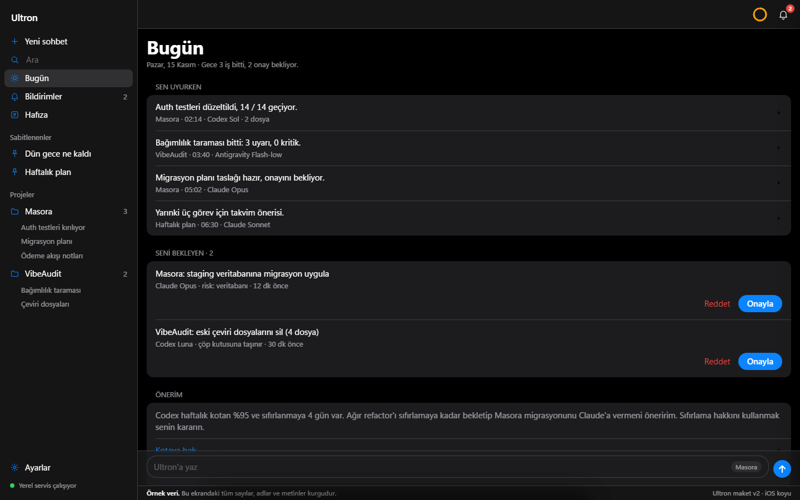
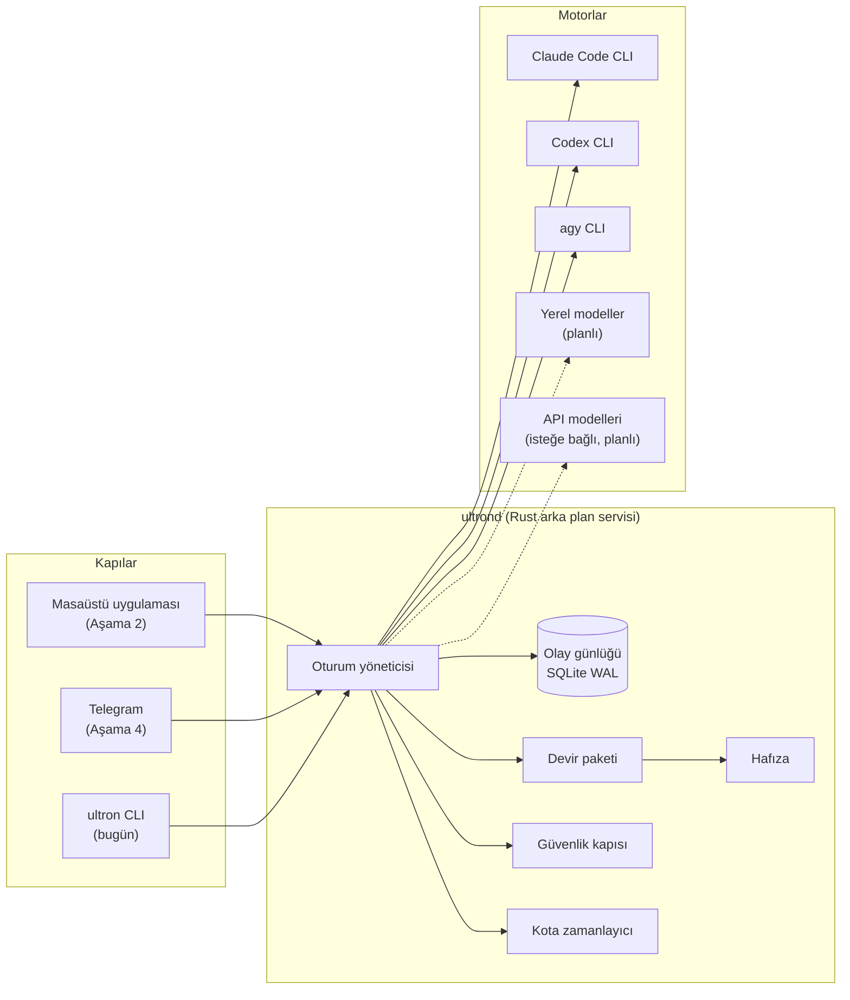

# Ultron

> Claude Code, Codex ve Antigravity (agy) CLI'larını kendi üyelikleriyle süren, ortak hafızası ve kayıpsız devir paketi olan kişisel bir AI harness'i.

**Ultron** is a personal AI harness for Windows that drives the Claude Code, Codex and Antigravity (agy) CLIs using the user's own subscriptions (no API keys by default). Every event is written to a durable log, conversations keep their state when the engine changes, and a handoff packet carries the decisions and next step to the new engine. Status: **Phase 1 of 7 (core) is implemented; the live acceptance is partial.** Turkish is the primary language of this document.

[](https://www.rust-lang.org/)
[](https://www.microsoft.com/windows)
[](#durum)
[](LICENSE)



*Masaüstü uygulaması maketi (Aşama 2, örnek veri)*

---

## Neden?

- Bir proje Claude ile başlar; kota bittiğinde Codex'e geçmek istendiğinde bağlam kaybolur, kararlar ve yarım kalan adımlar yeniden anlatılmak zorunda kalır.
- Kurallar, hafıza ve orkestrasyon bilgisi bugün tek bir motorun (Claude Code) içine dağılmış durumda; motordan bağımsız değil.
- Her geliştiricinin çalışma biçimi farklıdır. Ultron genel bir ürün değil; her kullanıcının kendi ihtiyacına göre şekillendirebileceği bir harness olmayı hedefler.

Temel ilke: **model gider, hafıza ve durum kalır.** Motorlar değiştirilebilir işçilerdir.

## Nasıl çalışır?



Temel fikirler:

- **Model gider, hafıza kalır.** Tam döküm, çalışma durumu ve kararlar harness'te tutulur; motor oturumuna bağımlı kalınmaz.
- **Devir paketi.** Motor değişince sistem talimatı, proje talimatları, çalışma durumu ve son mesajlar bağlam bütçesine göre yeni motora verilir. Kesildiyse bu pakette açıkça yazar.
- **Sessiz geçiş yok.** Her motor değişimi olay günlüğüne `EngineSwitched` olarak yazılır.
- **Beyin / işçi ayrımı.** Planlanan orkestrasyonda bir motor plan yapar, diğerleri işi yapar; Tam, Dengeli ve Eko modları bütçeyi belirler.
- **Güvenlik daemon'da zorlanır, prompt'ta değil.** Sabit kurallar ve izin kontrolleri ajanların değiştiremeyeceği çekirdekte durur.
- **Token tasarrufu temel ilkedir.** Gereksiz bağlam gönderilmez, ucuz işler ucuz modellere verilir.

## Durum

| Aşama | Kapsam | Durum |
|---|---|---|
| 1. Çekirdek | Servis iskeleti, SQLite şeması, olay günlüğü, motor sürücüleri, devir paketi, yerel IPC, CLI | **Tamamlandı (canlı kabul kısmi)** |
| 2. Masaüstü v1 | Tauri arayüzü, projeler ve sohbetler, canlı ajan izleme, kota paneli | Planlandı |
| 3. Güvenlik ve onay | Sabit kurallar arayüzü, çöp ve anlık görüntü, yerel onay modeli | Planlandı |
| 4. Telegram kapısı | Emir, onay, bildirim, otomatik devam | Planlandı |
| 5. İkinci beyin | Markdown kasası, kaynak makbuzları, hafıza önerileri, embedding araması | Planlandı |
| 6. Orkestrasyon v2 | Görsel yönlendirme, Tam/Dengeli/Eko modları, yerel ve API motorları, konsey | Planlandı |
| 7. Temsilci | Üçüncü kişilerle Telegram üzerinden görev yürütme | Planlandı |

**Aşama 1 ne sunuyor:** `ultrond` servis iskeleti; olaylar için idempotent SQLite günlüğü (WAL); Claude Code, Codex ve agy sürücüleri; tam döküm kaydı; çalışma durumu; devir paketi ve `history_search`; kullanıcıya özel adlandırılmış boru üzerinden yerel IPC; geçici bir terminal istemcisi (`ultron chat`, `ultron switch`).

**Canlı kabul sonuçları** ([ölçüm raporu](docs/reports/2026-11-15-asama1-olcum.md)):

- Claude → agy devri: **geçti.** Claude'da verilen karar agy tarafından doğru özetlendi; motor değişimi olayı günlüğe yazıldı.
- Claude → Codex devri: **henüz çalıştırılmadı** (Codex kullanım kotası nedeniyle). Test kodu derleniyor ve `#[ignore]` ile tutuluyor; bu yönde doğrulama yapılmış sayılmaz.
- Araç kısıtlama ölçümü: salt okunur modda, iki motorda da sentetik bir dosya silinmedi. Bu tek denemeye dayanan bir ölçümdür, kabul kapısı değildir.
- Bilinen sınırlar: agy'nin araç çağrıları olay günlüğünde henüz ayrıntılı görünmüyor; akış ölçümü kısa cevaplarla alındığı için kesin değil.

## Hızlı başlangıç (geliştirici)

**Gereksinimler**

- Windows 11
- Rust stable, MSVC toolchain (`stable-x86_64-pc-windows-msvc`) ve Visual Studio Build Tools (C++ masaüstü geliştirme bileşeni)
- `claude`, `codex` ve `agy` CLI'ları, her biri kullanıcının kendi hesabıyla giriş yapmış olmalı

**Derleme ve test**

```powershell
cargo build --workspace
cargo test --workspace
cargo clippy --workspace --all-targets -- -D warnings
```

**Örnek kullanım**

```powershell
# Claude ile yeni bir sohbet başlat ve bir mesaj gönder
ultron chat --engine claude "Bu projede CSV biçimini kullanacağız."

# Aynı sohbeti agy motoruna devret (EngineSwitched olayı yazılır)
ultron switch --chat <sohbet-id> --to agy

# Devir paketi ile devam et
ultron chat --chat <sohbet-id> "Son kararı ve sıradaki adımı özetle."
```

**Canlı testler hakkında:** Gerçek `claude`, `codex` ve `agy` çağıran testler `#[ignore]` ile işaretlidir ve kota harcar. Bunları yalnızca bilerek, isimle çalıştırın:

```powershell
cargo test -p ultrond --test live_acceptance live_claude_to_agy_handoff -- --ignored
```

Testler geçici `ULTRON_HOME` ve `ULTRON_PIPE_NAME` değerleriyle çalışır; gerçek kullanıcı verisine ve zamanlanmış görevlere dokunmaz.

## Güvenlik

- Yerel IPC, kullanıcı SID'ine bağlı adlandırılmış boru üzerinden çalışır; boru yalnızca o kullanıcıya izinlidir ve uzak istemciler reddedilir.
- Her başlangıçta üretilen rastgele belirteç yalnızca kullanıcıya izinli bir dosyada tutulur; el sıkışma `Hello` ile başlar ve belirteç sabit zamanlı karşılaştırılır.
- Çerçeve boyutu 1 MiB ile sınırlıdır; motor satırları ve tur çıktısı için de limitler vardır.
- Motor alt süreçleri izin atlama bayraklarıyla (`--dangerously-skip-permissions`, `bypassPermissions`, `danger-full-access`) başlatılmaz.
- Git çağrılarında fsmonitor, hooks, ext-diff ve filtreler devre dışıdır; `GIT_*` ortam değişkenleri temizlenir.
- Depoda sır, belirteç, kişisel veri veya mutlak kullanıcı yolu bulunmaz. Test fikstürleri sentetiktir; gerçek yakalamalar depo dışında tutulur.

**Güvenlik açığı bildirimi:** Lütfen açığı herkese açık bir issue olarak paylaşmayın. Repo'nun **Security** sekmesinden **Report a vulnerability** ile özel bir security advisory açın.

## Proje yapısı

```
crates/
  ultron-core/   Çekirdek kütüphane: yapılandırma, DB şeması, olaylar, motor sürücüleri,
                 çalışma durumu, devir paketi, IPC tipleri
  ultrond/       Arka plan servisi: adlandırılmış boru, belirteç, oturum yaşam döngüsü, canlı testler
  ultron/        Terminal istemcisi: chat, switch komutları
docs/
  superpowers/specs/   Tasarım belgesi (Türkçe, onaylı kararlar)
  superpowers/plans/   Aşama uygulama planları
  reports/             Ölçüm ve kabul raporları
  design/mockups/      Arayüz maketleri (HTML)
  assets/              README görselleri
AGENTS.md              Proje ve kod kuralları; crate düzeyinde AGENTS.md dosyaları ayrıntıyı verir
```

Tasarım belgesi: [docs/superpowers/specs/2026-11-15-harness-design.md](docs/superpowers/specs/2026-11-15-harness-design.md)

## Teşekkürler / Esinlenmeler

- Kodlama kuralları, [multica-ai/andrej-karpathy-skills](https://github.com/multica-ai/andrej-karpathy-skills) (MIT) deposundaki Andrej Karpathy esinli yönergelerden ilham almıştır.
- Hafıza tasarımındaki fikirler (Markdown kaynak, kaynak odaklı arama) `avenoxai/avenoxbeyin` projesinden esinlenmiştir.
- Rust tabanlı mimari yönü, Discord'un Rust ile yaptığı çalışmalardan esinlenmiştir.

"Ultron" projenin çalışma adıdır; Marvel veya başka bir markayla bağlantısı yoktur.

## Lisans

Bu proje [MIT Lisansı](LICENSE) altında lisanslanmıştır. Ayrıntılar için [LICENSE](LICENSE) dosyasına bakın.
